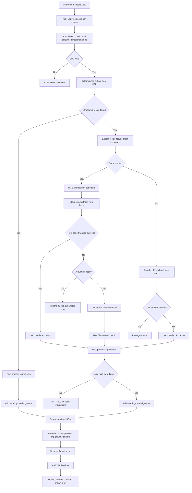

# Recipe Import Flow

This diagram documents the current end-to-end implementation for recipe import, from URL input through preview generation and final recipe creation.

Notes:
- Deterministic extraction includes JSON-LD and HTML/microdata fallbacks.
- The text-first AI fallback is attempted before WebFetch AI when URL parsing fails.
- Ingredient post-processing runs for both deterministic and AI paths.
